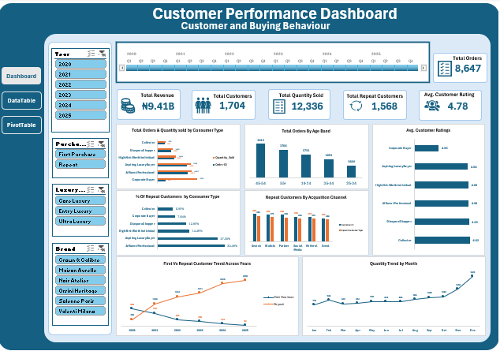

# Aurelle Luxury Customer Analysis

**Understand who buys from the company and identify opportunities to encourage repeat
purchases and improve customer experience.**

## Project Preview

## Project Overview

Write two or three short sentences explaining:

- Aurelle Luxury Collective is a luxury retailer selling handbags, watches,
jewellery, footwear, clothing, fragrances, accessories, travel goods and luxury home
products. It operates eight boutiques across seven cities and receives orders through its
website, social commerce, private appointments and corporate sales.
- The dashboard was created to analyze customer behaviour across Customer segments, purchasing preferences, acquisition channels and satisfaction.
- This project transforms raw business data into a clear and interactive Excel dashboard. Users can explore performance across different Customer segments, purchasing preferences, acquisition channels and satisfaction.

## From Data to Dashboard

The project started with a structured dataset, followed by data preparation, analysis, dashboard planning and final visualization in Excel.

### Source Data

## Dashboard Features

- KPIs: Revenue, total customers, Repeat customers, Quantity sold, Avg. customer rating, total orders
- First vs repeat customers across years
- Repeat customers by acqusition type
- Percentage of repeat customers by customer type
- Total orders by age
- Avg. customer rating
- quantity trend by month
- Slicers: years, Purchase type, Luxury type, brand

Example features:

- Interactive slicers
- Dynamic KPI cards
- Monthly trend analysis
- Product performance comparison
- Clean dashboard layout

## Files Included

| File | Description |
|---|---|
| `your-dashboard.xlsx` | Completed Excel dashboard |
| `Dashboard.png` | Preview of the final dashboard |
| `data.png` | Preview of the source data |
| `README.md` | Project documentation |

> Replace the example file names with the exact names used in your repository.

## How to Download and Use

1. Download `your-dashboard.xlsx`.
2. Open the workbook using Microsoft Excel.
3. Navigate to the dashboard worksheet.
4. Use the available filters and slicers to explore the results.

[Download the Excel Dashboard](your-dashboard.xlsx)

> GitHub may not open or preview Excel files in every browser. Downloading the workbook and opening it in Microsoft Excel is the safest option.

## Tools and Skills

- Microsoft Excel
- Excel formulas
- PivotTables
- PivotCharts
- Slicers
- Data analysis
- Dashboard design
- Data visualization
